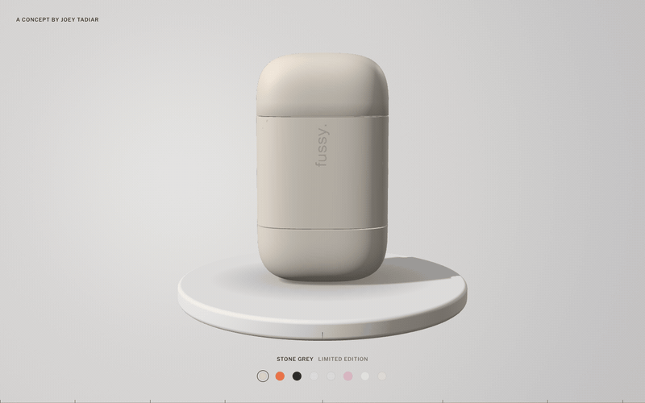

# Be fussy. A 3D product site

A scroll-driven 3D product site for Fussy's refillable deodorant case, with a colour picker that gives every colour its own personality.

**Live site:** [joeytadiar.com/fussy-3d](https://joeytadiar.com/fussy-3d/)

An unsolicited concept. Not affiliated with or endorsed by Fussy.

## Built with

- Blender, for the product model
- three.js, for the 3D scene in the browser
- Plain HTML, CSS and JavaScript, in one file

## How it works

**One file.** The whole site is `index.html`. The 3D model is stored inside it as text, so the page needs no other files and loads the product in one go. three.js comes from a public CDN.

**The model.** On load, the page turns the stored model back into a 3D object. It sorts the parts by name: lid, collar, refill, case and base. Each part then gets its own movement. Any model with the same part names would drop straight in.

**Scroll is the timeline.** Scrolling does not move the page. It moves a playhead through eight frames: Rest, Lift, Open, Parts, Drift, Orbit, Return and Rest again. Each frame sets where the parts sit, how the camera looks and how warm the light is. The page blends between frames, so the motion stays smooth at any speed. The loop has no end. Keep scrolling and it starts again.

**Built-in order.** Parts leave top first and come home bottom first, so the lid always lands last. Coming out of the orbit, every part squares up before the gaps close.

**Colour picker.** Pick a colour and the case closes, takes the new colour, then opens to show that colour's personality behind it. Scrolling at any point hands control straight back.

**Light.** One strong key light from the left, a soft rim and a contact shadow that follows the shape of the case. The background is drawn on its own canvas, with a faint fixed grain so the gradient never bands.

**Controls.** Scroll, swipe, the arrow keys or drag along the progress bar at the bottom.

## My role

Designed and built by Joey Tadiar. Concept, art direction, copy, interaction and code.

## Run it locally

1. `git clone https://github.com/jtadiar/fussy-3d.git`
2. `cd fussy-3d`
3. `python3 -m http.server 8000`
4. Open [http://localhost:8000](http://localhost:8000)

You need an internet connection for three.js and the web fonts.

---

Code © Joey Tadiar. Fussy and its product design belong to their owners.
